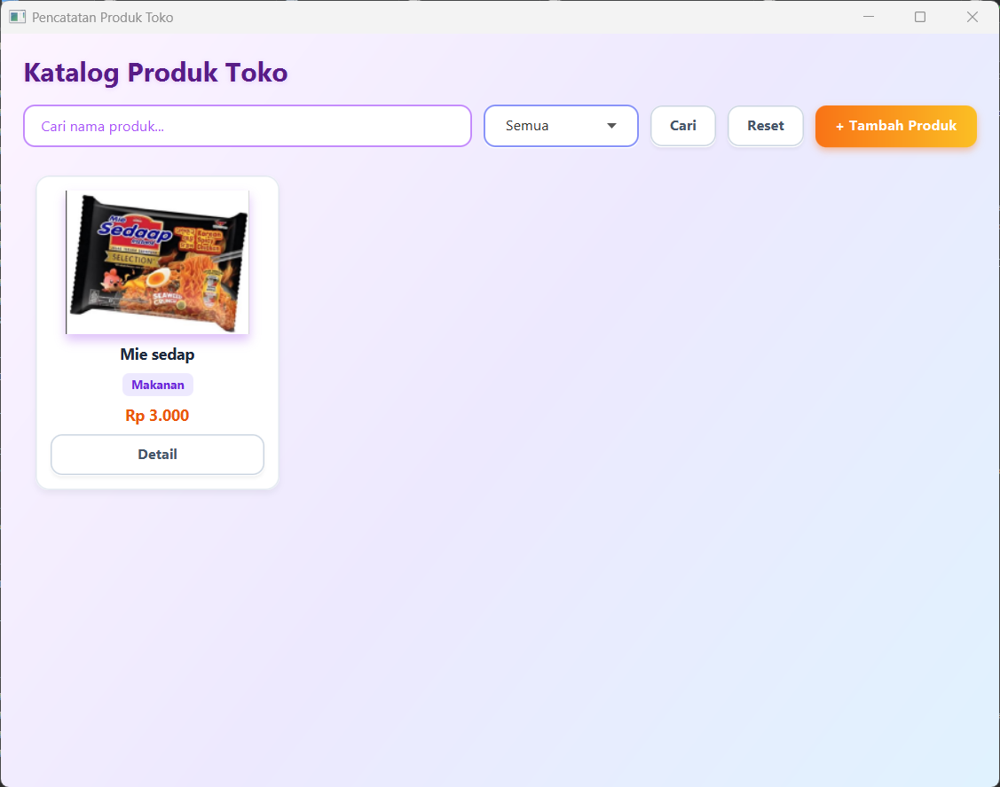
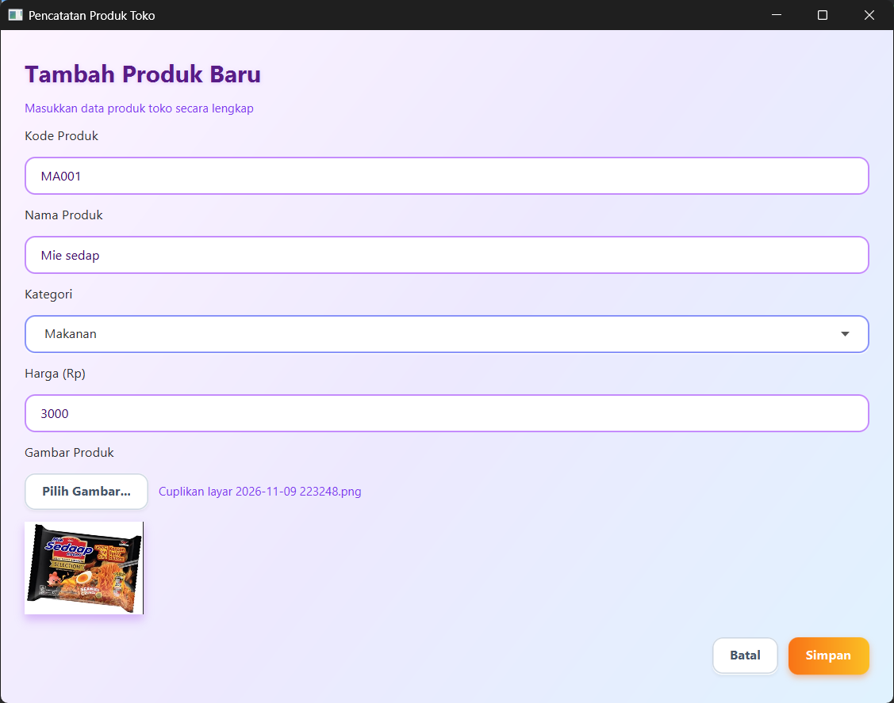
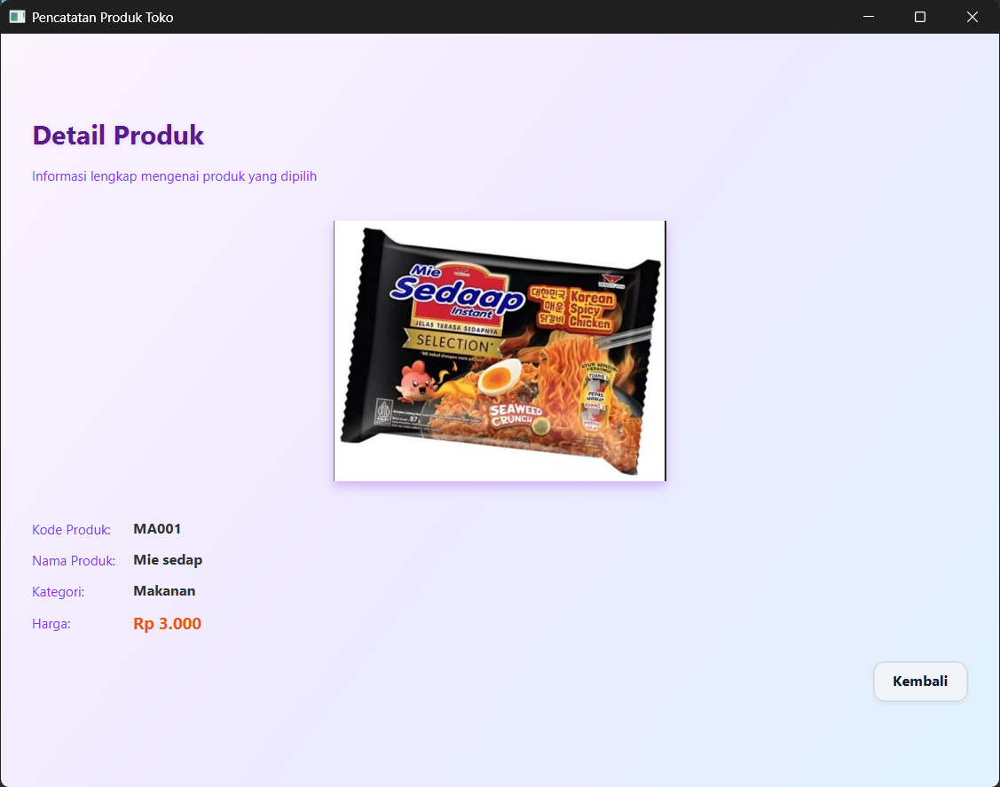

# Katalog Produk Toko

Aplikasi desktop sederhana berbasis JavaFX untuk mencatat dan mengelola katalog produk toko (makanan dan minuman)

## Screenshots

| Katalog Produk | Form Tambah Produk | Detail Produk |
| :---: | :---: | :---: |
|  |  |  |

## Cara Menjalankan

1. Clone repositori:
   `git clone https://github.com/username/DaftarProdukToko.git`
   `cd DaftarProdukToko`
2. Jalankan via Maven:
   `mvn clean javafx:run`
3. Atau jalankan melalui IDE (NetBeans / IntelliJ IDEA / VS Code):
   * Buka proyek sebagai Maven Project.
   * Lakukan Clean and Build.
   * Jalankan file utama: `src/main/java/kelas/MainApp.java`.
